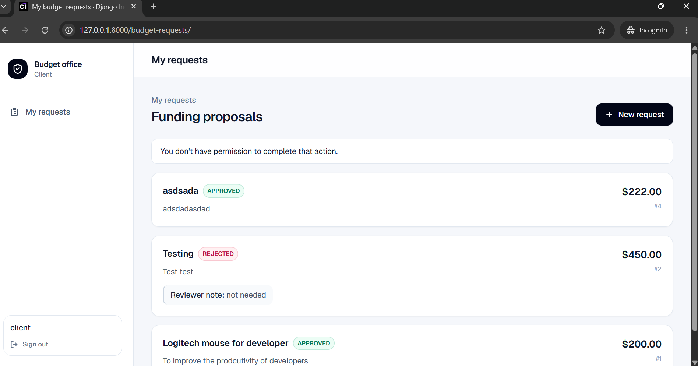
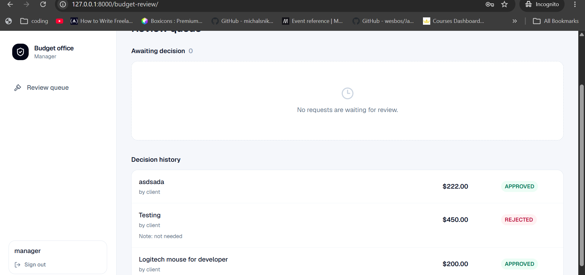
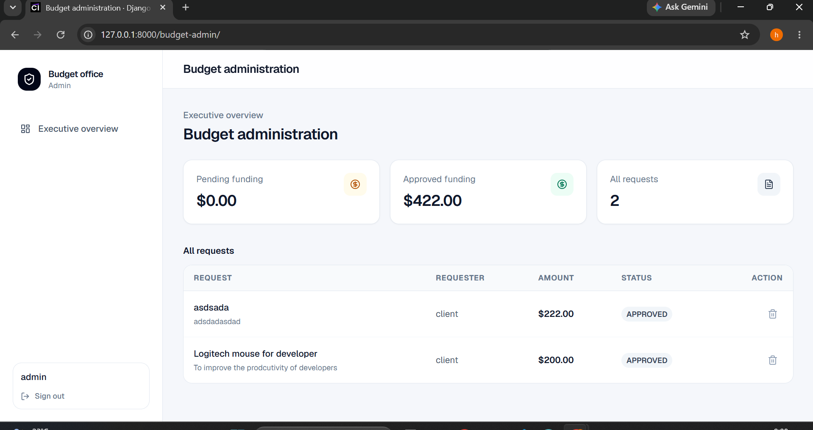

# Django + Inertia + React Budget Request App

A full-stack application built with Django, Inertia.js, and React. Django owns routing, authentication, permissions, and business rules. React renders the pages through Inertia.

## Loom walkthrough

[Watch the budget request role walkthrough](https://www.loom.com/share/3709af6c098a498a9ee0ad555857e208)

## Budget request roles

| Role | What they can do |
|---|---|
| Client | Submit budget requests and view their own requests. They can edit or withdraw requests while they are pending. |
| Manager | Review pending requests, approve them, or reject them with a review note. They can also view decision history. |
| Admin | View budget totals and all requests, and delete requests. |

Roles and permissions are enforced by Django. The budget pages are:

- Client: `/budget-requests/`
- Manager: `/budget-review/`
- Admin: `/budget-admin/`

The user and group management console is at `/admin/`. Django's built-in admin is at `/django-admin/`.

## Screenshots

| Client: my requests | Manager: review queue | Admin: budget overview |
|---|---|---|
|  |  |  |

See the [screenshot gallery](docs/screenshots.md) for the admin console screens.

## Requirements

- Python 3.12 or newer
- [uv](https://docs.astral.sh/uv/)
- Node.js 20.19 or newer, with npm

## PostgreSQL configuration

Django reads database settings from a `.env` file in the repository root, beside `pyproject.toml` (not inside `starterkit`). Add your PostgreSQL connection settings there:

```dotenv
DB_NAME=budget_request_db
DB_USER=postgres
DB_PASS=your_postgres_password
DB_HOST=localhost
DB_PORT=5432
```

Replace the example database name and password with your own values. Create the database in PostgreSQL if it does not already exist:

```sql
CREATE DATABASE budget_request_db;
```

Keep `.env` private and do not commit it. The PostgreSQL server must be running before you run Django commands.

## Run locally

Run these commands from the repository root.

### Django backend

```bash
uv run python starterkit/manage.py migrate
uv run python starterkit/manage.py createsuperuser
uv run python starterkit/manage.py runserver
```

`uv run` creates the Python environment and installs the project dependencies when needed. Django connects to the PostgreSQL database configured in `.env`.

### React frontend

Open a second terminal:

```bash
cd starterkit/frontend
npm install
npm run dev
```

Keep both servers running, then open **http://127.0.0.1:8000/**.

Create a superuser for administration. To test the budget workflow, create users and assign them to Django groups named exactly `Client`, `Manager`, or `Admin`.

## Optional background jobs

Redis, Celery Worker, and Celery Beat are only needed for background and scheduled jobs.

```bash
docker compose up -d
cd starterkit
uv run celery -A main worker -l info
uv run celery -A main beat -l info
```

See [Background tasks](docs/background-tasks.md) for details.

## Tests and checks

```bash
uv run python starterkit/manage.py test
```

From `starterkit/frontend`:

```bash
npm run lint
npm test
npm run build
```

## Project structure

```text
starterkit/
├── main/                  Django settings, URLs, middleware, and Celery app
├── apps/admin_panel/      Inertia admin console
├── apps/budget_request/   Budget request workflow and role policies
├── templates/             Inertia root template
└── frontend/              React pages, layouts, components, and Vite config
```

## Documentation

- [Getting started](docs/getting-started.md)
- [Architecture](docs/architecture.md)
- [Permissions](docs/permissions.md)
- [Frontend](docs/frontend.md)
- [Background tasks](docs/background-tasks.md)
- [Configuration](docs/configuration.md)
- [Deployment](docs/deployment.md)
- [Testing](docs/testing.md)

## License

MIT.
